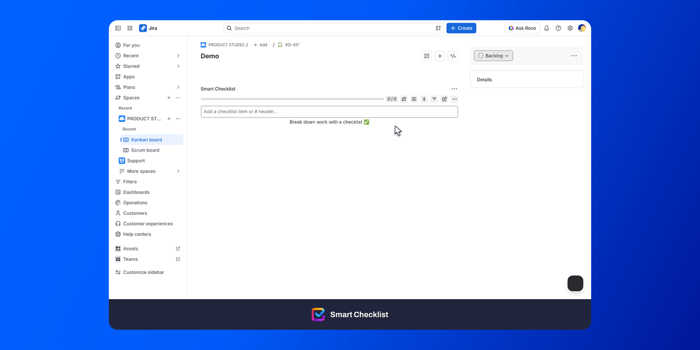

# Markdown checklist templates for Smart Checklist

**Create checklists in Markdown format compatible with the Smart Checklist app for Jira.** This repository gives users and LLMs 78 reusable Markdown checklist templates organized by 12 teams, a formatting guide, and a skill for creating or adapting checklists. The formatting guide targets the app's **Jira Cloud** edition.

**[Browse templates](templates/README.md)** · **[Formatting guide](skills/write-jira-checklist/references/formatting-guide.md)** · **[Writing skill](skills/write-jira-checklist/SKILL.md)**

The collection covers Definition of Done, code review, onboarding, releases, QA, marketing, finance, procurement, and support. Template files contain only checklist Markdown, ready to adapt to your process.

## From Markdown to Smart Checklist

Watch Markdown become a formatted checklist in Smart Checklist, including mandatory items, details, links, statuses, dates, and an embedded image.

<a href="docs/images/smart-checklist-markdown-import.gif"></a>

Click the demo to enlarge. See the [formatting guide](skills/write-jira-checklist/references/formatting-guide.md) for exact syntax.

## Use this repository

### For users

1. Find a template in the directory and open its `.md` file. Template files contain only checklist content, with no frontmatter to remove.
2. Replace placeholders with the appropriate values, keeping the surrounding Markdown syntax. All placeholders use descriptive names without curly brackets, such as `document_url`, `due_date`, and `employee_name`. See the examples below.
3. Copy the file's raw text into the Smart Checklist full-screen editor on a Jira issue. GitHub's rendered Markdown is a preview, not the Smart Checklist renderer.
4. Review the result and save it as a template in the app if you want to reuse it.

Placeholders are draft markers, not app variables. Replace only the name, preserving the syntax around it:

| Value | Draft syntax | Replace the placeholder with |
| --- | --- | --- |
| Assignee | `[assignee="assignee_user_id"]` | The responsible person's Jira user ID, keeping the quotes and brackets. |
| User mention | `@reviewer_user_id` | A Jira user ID, keeping `@`. A mention is separate from a dedicated assignee. |
| Link | `[Document](document_url)` | The document URL, keeping the link label and parentheses. |
| Image | `` | The image URL, keeping `!`, the alt text, and parentheses. |
| Item due date | `[dueDate="due_date"]` | A valid date in `YYYY-MM-DD` format, keeping the quotes and brackets. |

Put assignee and due-date attributes immediately after the item status marker. A name or role such as `@DesignLead` is a custom mention label, not a confirmed Jira user ID. Dates in headings or ordinary text provide context; the dedicated due-date column uses the `dueDate` attribute. See the [formatting guide](skills/write-jira-checklist/references/formatting-guide.md) for full examples.

### For LLMs and coding agents

Start with [llms.txt](llms.txt) and the [writing skill](skills/write-jira-checklist/SKILL.md). Search the compact [index](templates/index.json), then read the selected [catalog](templates/catalog.json) entries and template files. The catalog contains placeholders, adaptation notes, sources, and stable IDs; retired IDs resolve through `superseded_ids`.

[Download the skill ZIP](skills/write-jira-checklist.zip) or copy `skills/write-jira-checklist/` into your agent's supported skill directory, including its `references/` and `scripts/` folders. The skill works on its own; keep this repository available to reuse its templates. Agents without skill support can read `SKILL.md` as task instructions.

### Skill walkthrough

This illustrative exchange shows how the skill can adapt [T024: Release Readiness](templates/it-and-engineering/t024-release-readiness-and-approval.md):

**Request:** “Create a short release-approval checklist for our web app. Require review of the QA report and rollback plan, then final approval.”

**Missing details:** The skill asks for the report and rollback-plan links, the approver's Jira user ID, and whether approval has a deadline. If you want a draft first, it leaves explicit placeholders:

```text
## Release approval
- Review [the QA report](qa_report_url)
- Verify [the rollback plan](rollback_plan_url)
-! [assignee="approver_user_id"][dueDate="approval_due_date"] Approve the release
```

**Before use:** Replace the four placeholders, or remove the due-date attribute if no deadline is needed. The skill checks the Markdown against the formatting guide and, when it can run Python, the bundled linter. Copy only the checklist into Smart Checklist and review the rendered result.

## How this fits Jira work

**Smart Checklist for Jira** is a checklist app by TitanApps on the [Atlassian Marketplace](https://marketplace.atlassian.com/apps/1216451/smart-checklists-for-jira?hosting=cloud&tab=overview). It keeps checklist items inside Jira work items, so a team can follow a shared process alongside the work it describes.

Use a checklist template for related action items, repeatable to-do lists, acceptance criteria, or a shared Definition of Done. For example, adapt the [Definition of Done template](templates/it-and-engineering/t017-definition-of-done.md) for your team's quality standards, or the [release readiness template](templates/it-and-engineering/t024-release-readiness-and-approval.md) for QA and deployment approvals. Use subtasks when a piece of work needs its own issue lifecycle, discussion, or time tracking. [Checklist versus subtask guidance](https://titanapps.io/blog/jira-subtasks-vs-checklists).

### Give each step an owner and context

A checkbox records completion. An assignee and priority make ownership and urgency clear, while due dates help teams plan handoffs. Checklist items can have their own responsible users, independently of the parent Jira issue's assignee. Add details, links, and images to explain the expected result and where to find evidence. The Markdown examples above show how to include these values when adapting a template. [Item attributes](https://railsware.atlassian.net/wiki/spaces/CHK/pages/5861736450) and [formatting options](https://railsware.atlassian.net/wiki/spaces/CHK/pages/90636343/Formatting+Guide).

For longer processes, organize related checks under headers. If you need multiple checklists for Jira release work, for example, separate QA, deployment, and communication into their own sections. In Tab view, each level-one Markdown header (`# `) becomes a tab with its own progress indicator. [Checklist tabs](https://railsware.atlassian.net/wiki/spaces/CHK/pages/5379194882/Checklist+Tabs).

### Reuse checklists as work moves forward

Save an adapted checklist as a template in the app, then apply it automatically at issue creation, when a field changes, or when a work item transitions. Conditions can use the issue type or a label: for example, apply a release checklist to work items labeled `release`, or a Definition of Done checklist to stories. Advanced conditions require a plan that includes them. [Default template conditions](https://railsware.atlassian.net/wiki/spaces/CHK/pages/1294532651/Set+a+Template+as+Default).

For recurring tasks such as monthly reviews, reuse the same template to keep recurring checklists consistent. Jira Automation can import saved checklist templates as part of a configured rule; use a [scheduled trigger](https://support.atlassian.com/cloud-automation/docs/jira-automation-triggers/) to create the recurring work items when needed. In Jira Cloud, the `Checklists` custom field stores the raw Markdown. This checklist text field is also useful when an automation rule needs to add or update checklist content. [Template automation](https://railsware.atlassian.net/wiki/spaces/CHK/pages/3921543201/Use+Templates+in+Automations) and [custom fields](https://railsware.atlassian.net/wiki/spaces/CHK/pages/1372422219/Custom+Fields+Setup).

For required approvals, mark the relevant items mandatory with `-!`. In company-managed projects, a Jira workflow validator can block a transition until those items are complete. This requires a plan that includes validators and configuration in Jira separately from the Markdown. [Mandatory-item completion validator](https://railsware.atlassian.net/wiki/spaces/CHK/pages/3807641616).

### Follow progress across the team

Use JQL search to find work items by checklist content and supported checklist properties. You can also display the `Smart Checklist Progress` custom field on an agile board to see completion progress without opening every work item. [JQL search](https://railsware.atlassian.net/wiki/spaces/CHK/pages/152961090/JQL+Search) and [progress field](https://railsware.atlassian.net/wiki/spaces/CHK/pages/1372422219/Custom+Fields+Setup).

For service requests, Smart Checklist can show customers a read-only checklist on the Jira Service Management customer portal. Enable portal visibility in both global and project settings to let customers follow progress while your team maintains the checklist. [Customer portal setup](https://railsware.atlassian.net/wiki/spaces/CHK/pages/3687874561).

## Compatibility and testing

The formatting guide targets **Jira Cloud**. Smart Checklist uses status prefixes such as `-` for To Do and `-!` for mandatory items, rather than GitHub's `- [ ]` checkbox syntax. Text labels do not set Jira fields, and mandatory markers do not configure workflow validators.

Read the catalog's adaptation notes before reuse. T021 is a historical Server-to-Cloud migration example; T075 is product-specific regression testing with illustrative JQL, while T073 covers general regression. Security, legal, and financial templates need adaptation to your requirements.

The [27 November 2026 import report](docs/import-validation-2026-11-27.md) records save/render smoke tests for the 78 versions tested that day, with representative visual checks. Current catalog entries retain evidence only while their content hashes match. T021's duplicate-item cleanup has not been retested in Jira. See the [test procedure and limits](docs/import-validation.md).

## Repository layout

| Folder | What you will find |
| --- | --- |
| [templates/](templates/README.md) | Checklist Markdown by team, plus the compact index and full catalog for agents. |
| [skills/](skills/write-jira-checklist/SKILL.md) | The writing skill, its formatting guide, and the downloadable skill ZIP. |
| [docs/](docs/README.md) | Animated demo, source attribution, and compatibility evidence. |
| [tools/](tools/README.md) | Optional search, validation, and maintenance tools. No setup is needed to use the templates. |

To add or improve a checklist, see the [contribution guide](.github/CONTRIBUTING.md). Report malicious content through the [security policy](.github/SECURITY.md). Only the latest snapshot is public; see the [publication policy](docs/publication.md).

## Reuse and attribution

Copy, adapt, and reuse the repository under the [MIT license](LICENSE), retaining its notice. See [NOTICE](NOTICE) and [sources](docs/sources.md) for source attribution. Product names and trademarks remain with their respective owners. This repository contains templates and guidance; the Smart Checklist app has its own license.
